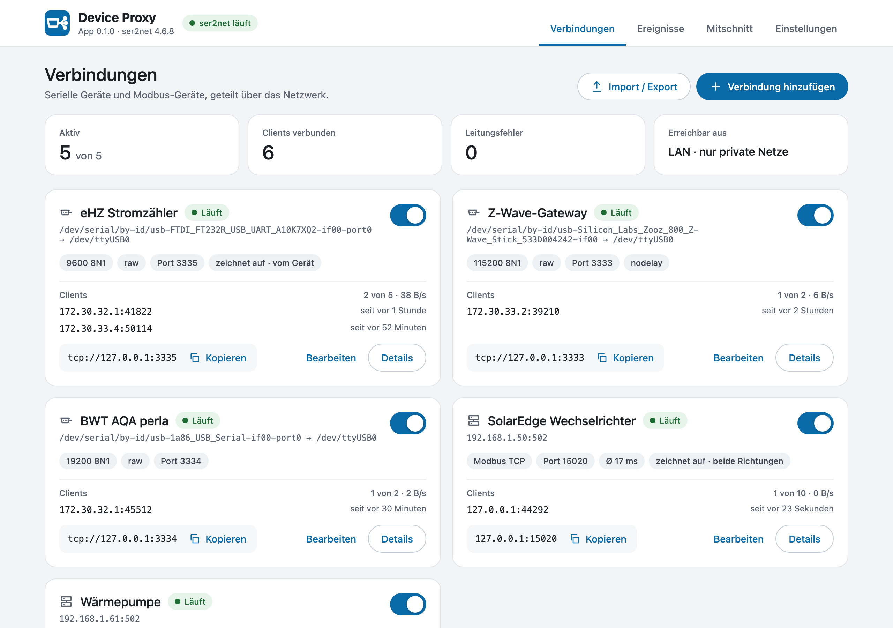
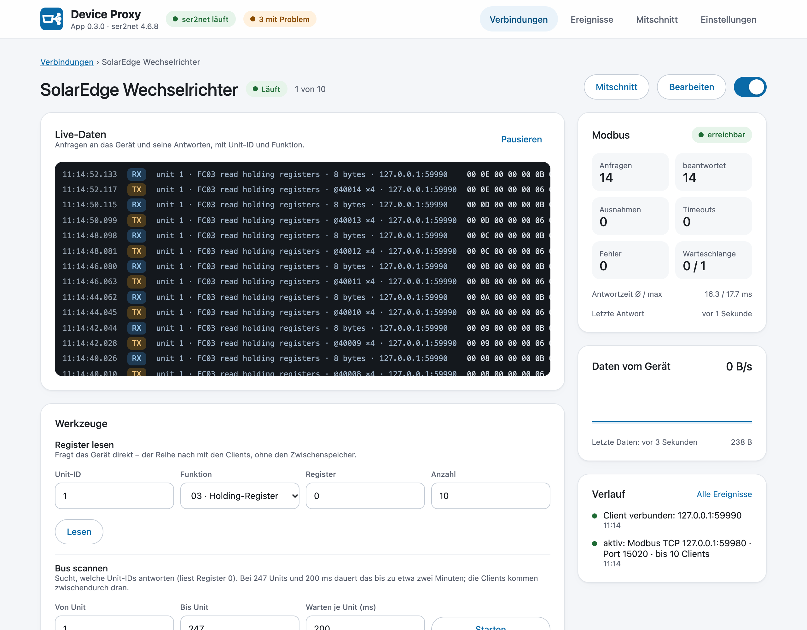
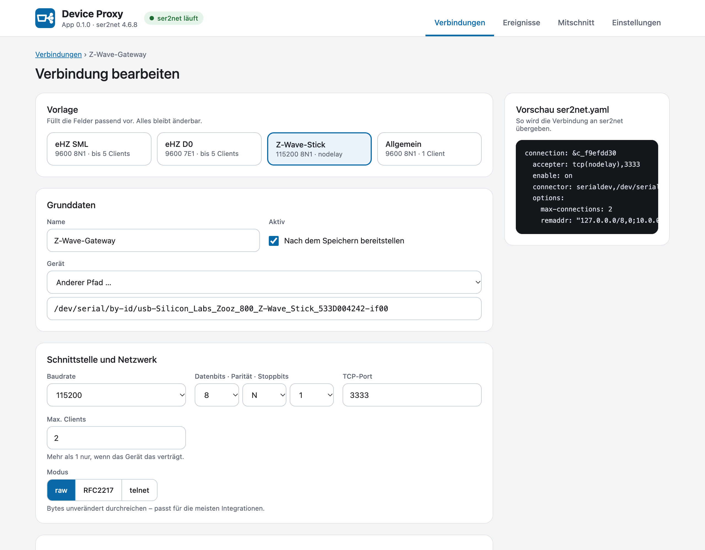
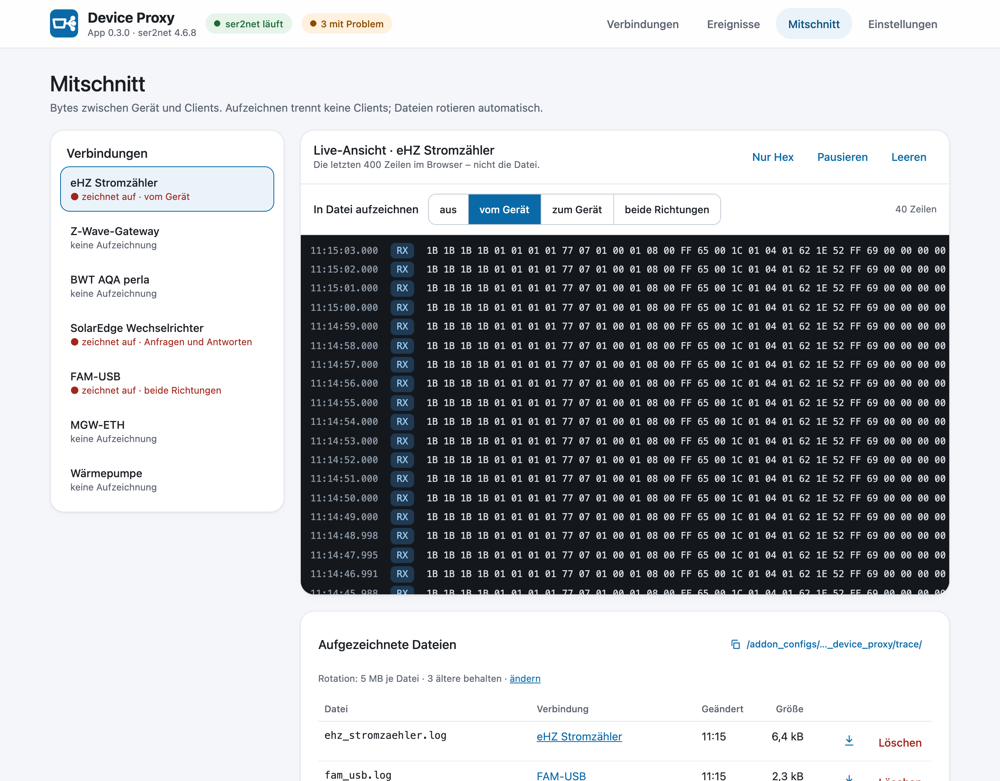
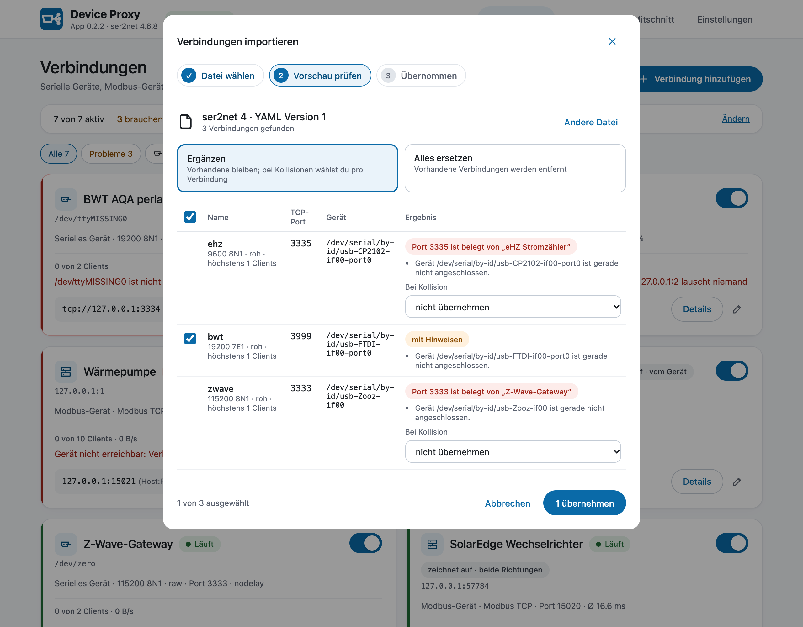
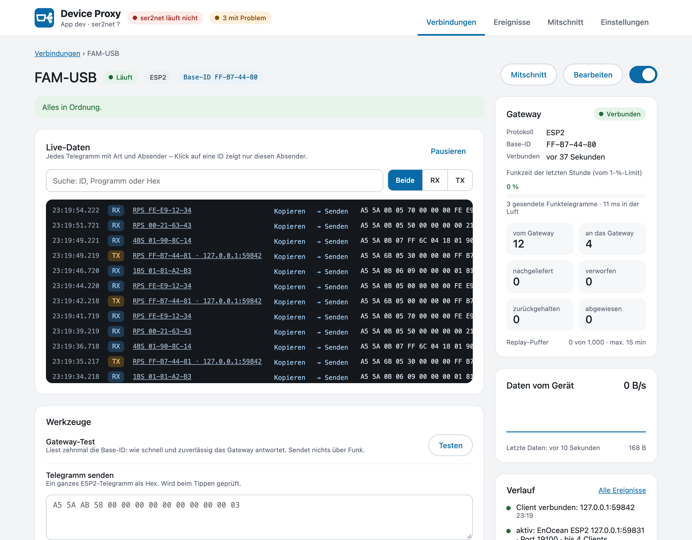

<p align="center">
  
</p>

<h1 align="center">Device Proxy</h1>

<p align="center">
  Serielle, USB-, Modbus- und EnOcean-Geräte mit mehreren Programmen teilen: ser2net, ein Modbus-Proxy und ein EnOcean-Proxy als Home-Assistant-App.
</p>

<p align="center">
  <a href="https://www.home-assistant.io/"></a>
  <a href="device_proxy/config.yaml"></a>
  
  <a href="https://github.com/bertel2020/HA-Device-Proxy/actions/workflows/ci.yml"></a>
  <a href="LICENSE"></a>
</p>

<p align="center">
  <a href="https://buymeacoffee.com/bertel2020"></a>
  <a href="https://ko-fi.com/bertel2020"></a>
  <a href="https://paypal.me/RobertoMartins"></a>
</p>

<p align="center"><em><a href="https://github.com/bertel2020/HA-Device-Proxy/blob/main/README.md">English version</a></em></p>

Device Proxy ist eine Home-Assistant-App (früher Add-on), die ein Gerät für mehrere Programme gleichzeitig nutzbar macht. Serielle und USB-Geräte (Lesekopf am Stromzähler, Z-Wave- oder Zigbee-Stick, RS232-Geräte) werden mit [ser2net 4](https://github.com/cminyard/ser2net) über TCP geteilt. Modbus-Geräte (Modbus TCP, Modbus RTU an RS485, RTU über TCP) teilt der eigene Modbus-Proxy der App mit mehreren Modbus-TCP-Clients. EnOcean-Gateways (FAM-USB, FAM14, USB300, MGW-ETH …) teilt ihr eigener EnOcean-Proxy, mit Nachlieferung bei Neustarts von Home Assistant.

Eingerichtet wird alles in einer Weboberfläche in der Seitenleiste, ohne YAML und ohne Kommandozeile. Status, Live-Daten, Mitschnitt und Ereignisse zeigen, was auf der Leitung passiert.

> In Arbeit, noch nicht auf Home Assistant getestet. Braucht Home Assistant OS oder Supervised (Apps laufen unter dem Supervisor).

## Einblicke

<p align="center">
  
</p>

| Modbus-Gerät | Verbindung bearbeiten |
| --- | --- |
|  |  |

| Mitschnitt | Import |
| --- | --- |
|  |  |

<p align="center">
  
</p>

## Warum Device Proxy?

Viele Geräte nehmen nur eine Verbindung an: der USB-Lesekopf am Zähler, der Z-Wave-Stick, der Modbus-TCP-Port des Wechselrichters, ein RS485-Bus. Sobald ein zweites Programm die Daten will (ein zweites Home Assistant, evcc, ein Energiemanager, ein Diagnosewerkzeug), kommen sie sich in die Quere oder eines verliert.

Device Proxy sitzt dazwischen. Die App hält das Gerät, lässt mehrere Clients darauf zugreifen, wo das Protokoll es verlangt der Reihe nach, und zeigt, wer verbunden ist und ob Daten fließen. Was früher in einer `ser2net.yaml` oder in den Optionen verschiedener Apps stand, ist an einer Stelle.

## Highlights

- **Verbindungen in einer Weboberfläche**: Gerät aus einer Liste mit stabilen Namen, Vorlagen (Zähler SML oder D0, Z-Wave-Stick, Modbus), alle wichtigen ser2net-Optionen und eine Vorschau der `ser2net.yaml` beim Tippen. Speichern baut nur diese Verbindung neu auf; die anderen behalten ihre Clients.
- **Modbus-Proxy**: ein Modbus-Gerät oder RS485-Bus für mehrere Modbus-TCP-Clients. Anfragen gehen nacheinander ans Gerät, jede Antwort zurück an den, der gefragt hat; Timeouts, Wiederholungen und Pausen sind einstellbar. Schreiben standardmäßig nur aus Home Assistant und den Apps, Zwischenspeicher für Lesezugriffe, Bus-Scan und Register lesen.
- **EnOcean-Gateways**: ein FAM-USB, FAM14, USB300 oder MGW-ETH gleichzeitig für die Integration EnOcean Eltako, eo_man und PCT14. Ganze Telegramme der Reihe nach, Antworten an das fragende Programm, Telegramme aus einem Neustart von Home Assistant mit Empfangszeit nachgeliefert, Erkennung durch die Integration. Live-Telegramme mit Absender und Art, Funkzeit gegenüber dem 1-%-Limit, Gateway-Test, geprüftes Senden, Mitschnitt mit Sperre für PCT14. Löst die App EnOcean Proxy ab.
- **Status auf einen Blick**: Gerät vorhanden, Clients mit Adresse und Bytes, Datenrate, letzte Daten, Leitungsfehler vom Treiber, Modbus-Anfragen und Antwortzeiten; Clients, die nicht mehr lesen, werden erkannt.
- **Live-Daten und Mitschnitt** ohne Client-Platz, bei Modbus dekodiert; Aufzeichnung in rotierende Dateien, ohne jemanden zu trennen.
- **Werkzeuge für Zähler**: SML (mit CRC-Prüfung) und D0 auswerten, Baudrate erkennen.
- **Import und Export**: ser2net-4-`ser2net.yaml`, ser2net-3-`ser2net.conf`, die Optionen der Apps ha-modbusproxy oder EnOcean Proxy oder eine modbus-proxy-Datei, jeweils mit Vorschau. Oder die eigene `ser2net.yaml` direkt verwenden.
- **Ereignisse und Historie** (30 Tage, Abbrüche und Verfügbarkeit), Konfig-Historie mit Unterschieden und Wiederherstellen.
- **Benachrichtigungen** in Home Assistant, optional aufs Handy, und **Entitäten über MQTT-Discovery**: ein Gerät je Verbindung mit Zustand und Schalter.
- Deutsch und Englisch, hell und dunkel (nach dem Theme von Home Assistant), Handy-tauglich.

## Schnellstart

1. Dieses Repository mit dem Button unten zu Home Assistant hinzufügen, oder unter **Einstellungen → Apps → App-Store → ⋮ → Repositories** mit `https://github.com/bertel2020/HA-Device-Proxy`.

   [](https://my.home-assistant.io/redirect/supervisor_add_addon_repository/?repository_url=https%3A%2F%2Fgithub.com%2Fbertel2020%2FHA-Device-Proxy)

2. **Device Proxy** installieren und starten. Solange es keine fertigen Images gibt, baut Home Assistant die App bei der Installation selbst (mit gensio und ser2net); das dauert beim ersten Mal einige Minuten.
3. In der Seitenleiste **Device Proxy** öffnen und eine Verbindung hinzufügen: Gerät und Vorlage wählen, speichern. Die Karte zeigt die Adresse für die Integration, etwa `tcp://127.0.0.1:3333` oder Modbus-Host und Port.
4. Bisher ser2net, ha-modbusproxy oder die App EnOcean Proxy im Einsatz? **Import / Export** übernimmt die vorhandene Konfiguration mit Vorschau.

Alle Seiten, alle Einstellungen und Hilfe, wenn etwas nicht geht: **[Dokumentation](device_proxy/DOCS.md)** (auch in Home Assistant im Reiter „Dokumentation“ der App).

## Sicherheit in Kürze

- Die Ports sind roher TCP ohne Anmeldung. Neue Verbindungen nehmen Clients nur aus privaten Netzen an; die Z-Wave-Vorlage beschränkt sie auf Home Assistant und seine Apps. Unter **Einstellungen → Netzwerk** lässt sich das weiter einschränken.
- Modbus-Verbindungen lassen standardmäßig nur Home Assistant und die Apps schreiben; andere Clients dürfen nur lesen. EnOcean-Gateways nehmen nur Home Assistant und die Apps an, solange keine weiteren Adressen erlaubt sind.
- Die Admin-Schnittstelle von ser2net ist nur innerhalb der App erreichbar; die Weboberfläche nur über Home Assistant (Ingress).
- Die Diagnose lässt Hostnamen und Personennamen weg.

## Änderungen

Siehe [device_proxy/CHANGELOG.md](device_proxy/CHANGELOG.md); Home Assistant zeigt sie vor einem Update an.

## Entwicklung

```bash
python -m pip install -r requirements_test.txt
ruff check .
mypy
python -m pytest
```

Die Weboberfläche wird aus `panel-src/` gebaut (dort `npm ci && node build.mjs`); `tools/dev_server.py` startet sie auf einem Desktop mit Beispielverbindungen. `tools/render_images.py` zeichnet `icon.png` und `logo.png`.

## Dank

Der EnOcean-Teil baut auf der Arbeit anderer auf:

- [grimmpp](https://github.com/grimmpp) (Philipp Grimm) für [home-assistant-eltako](https://github.com/grimmpp/home-assistant-eltako), [eltako14bus](https://github.com/grimmpp/eltako14bus) und [esp2_gateway_adapter](https://github.com/grimmpp/esp2_gateway_adapter), den Ursprung der Eltako-Unterstützung. `eltako14bus` geht auf Christian Amsüss und Energy Harvesting Solutions (2016–2020) zurück.
- [chrysn](https://github.com/chrysn), Johannes Bosecker, Cedric Van Labeke und LHBL2003, die zu `home-assistant-eltako` beigetragen haben.
- Kimmo Huoman ([kipe/enocean](https://github.com/kipe/enocean), über den Fork [mak-gitdev/enocean](https://github.com/mak-gitdev/enocean)) für die EnOcean-Protokollbibliothek.

## Haftungsausschluss

Device Proxy ist ein privat entwickeltes, kostenloses Open-Source-Projekt und wird ohne Gewähr und ohne Garantie bereitgestellt. Die Nutzung erfolgt auf eigene Verantwortung; insbesondere kann keine Garantie für fehlerfreien Betrieb, für die Erreichbarkeit der geteilten Geräte oder für die Richtigkeit der durchgereichten Daten übernommen werden. **Device Proxy reicht Daten und Befehle von Clients an deine Geräte weiter, auch Schreibzugriffe auf Modbus-Geräte wie Wechselrichter oder Wärmepumpen. Prüfe, wer sich verbinden und schreiben darf, bevor du ein Gerät im Netz freigibst.**

## Lizenz

Dieses Projekt steht unter der [MIT-Lizenz](LICENSE).
Copyright 2026 Roberto / bertel2020.
ser2net und gensio (beide GPL-2.0, siehe deren Repositories) werden aus ihren Releases ins Image gebaut.
