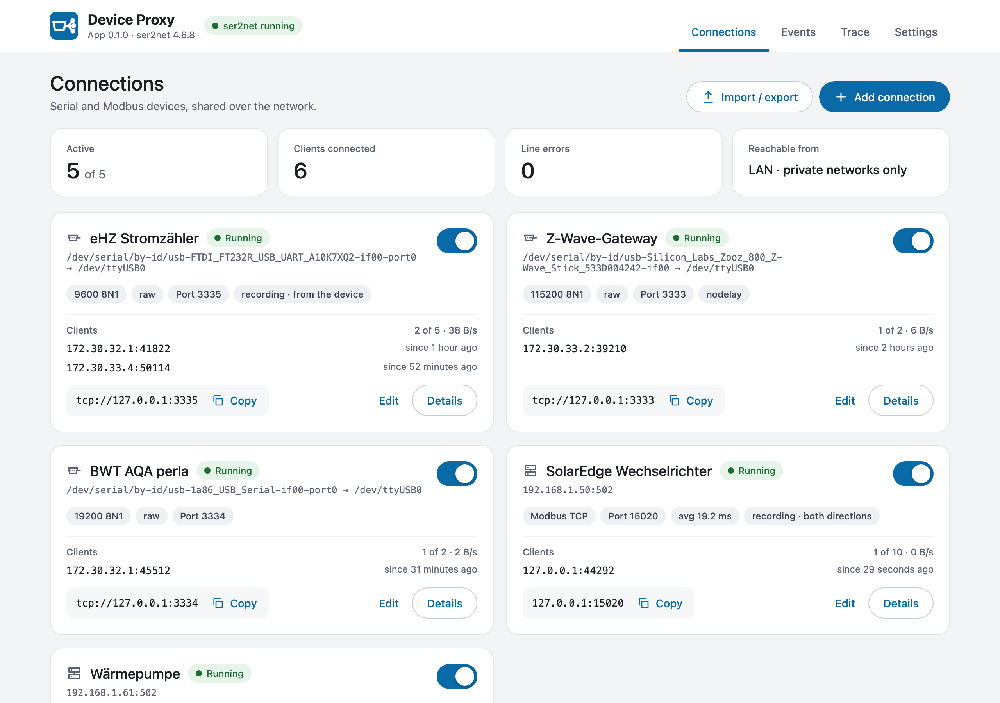
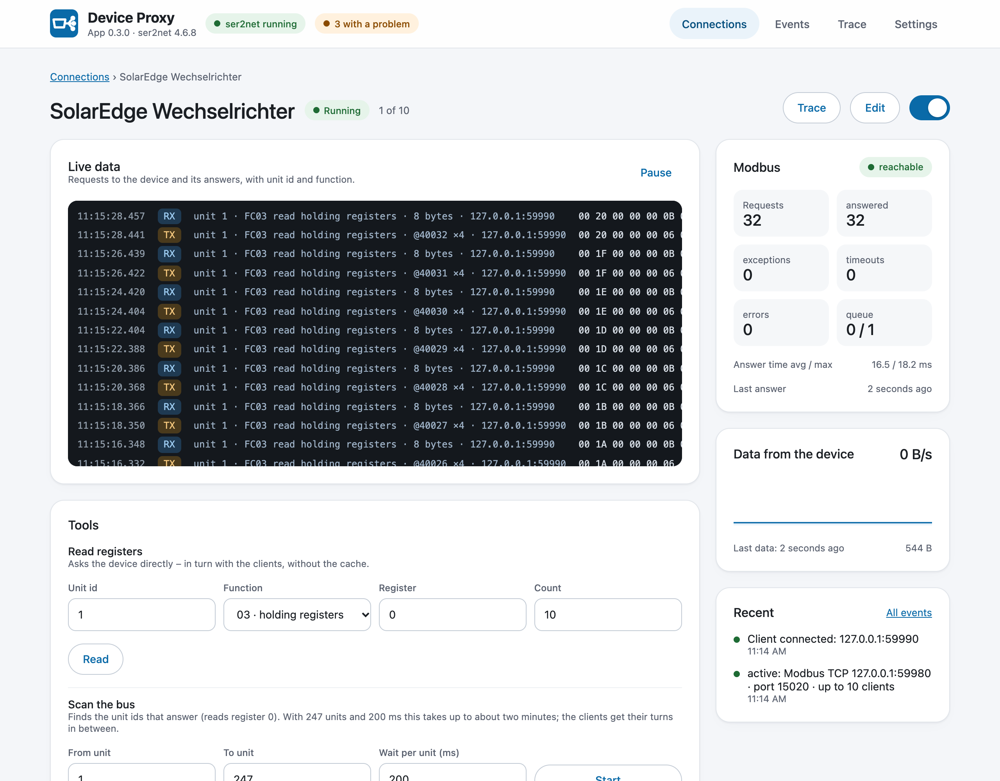
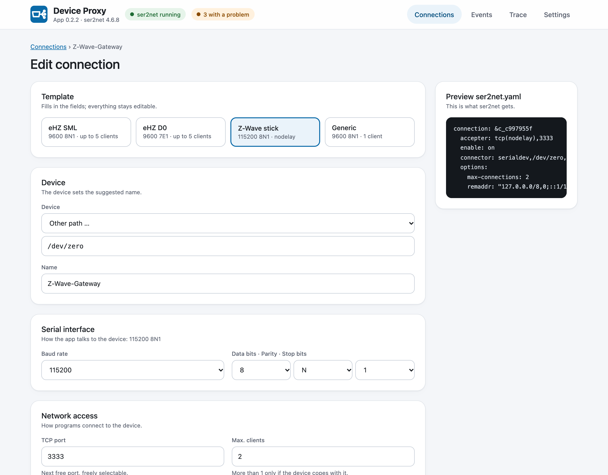
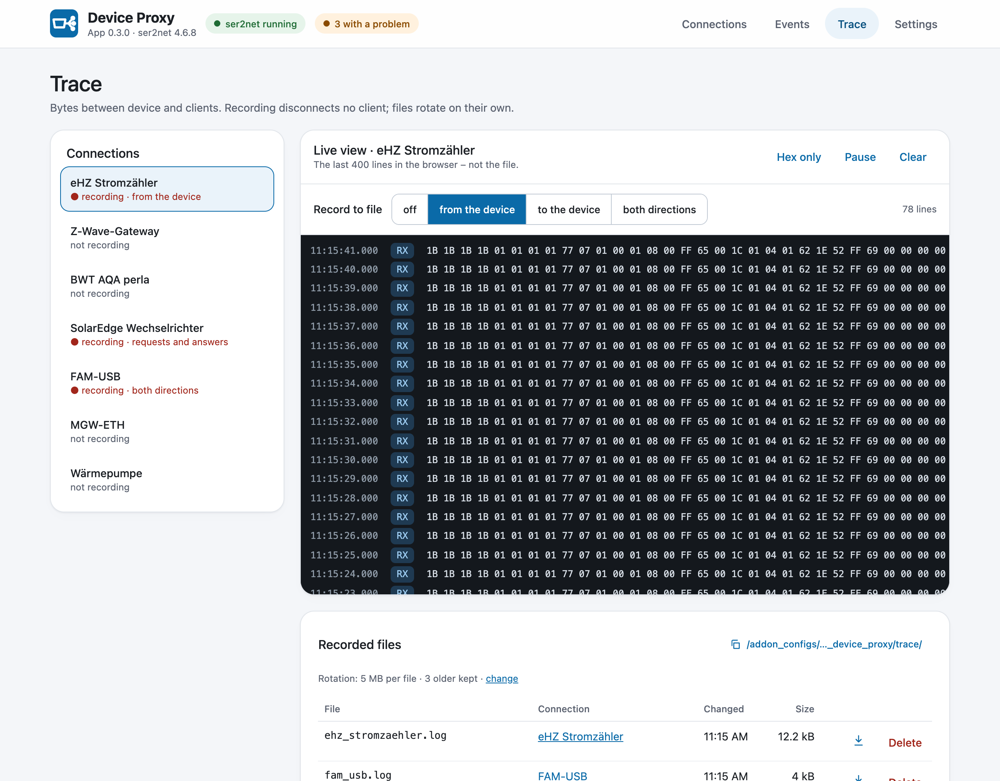
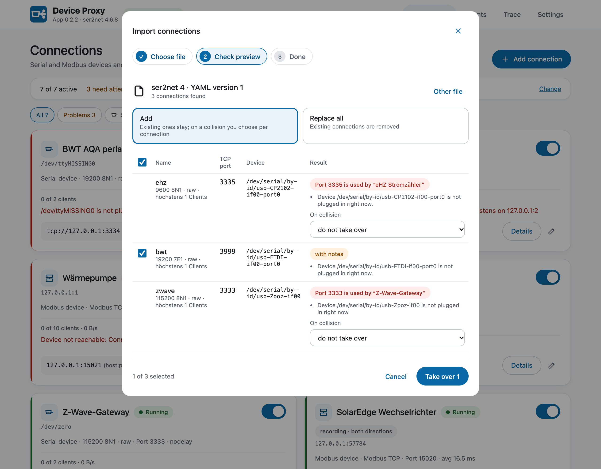
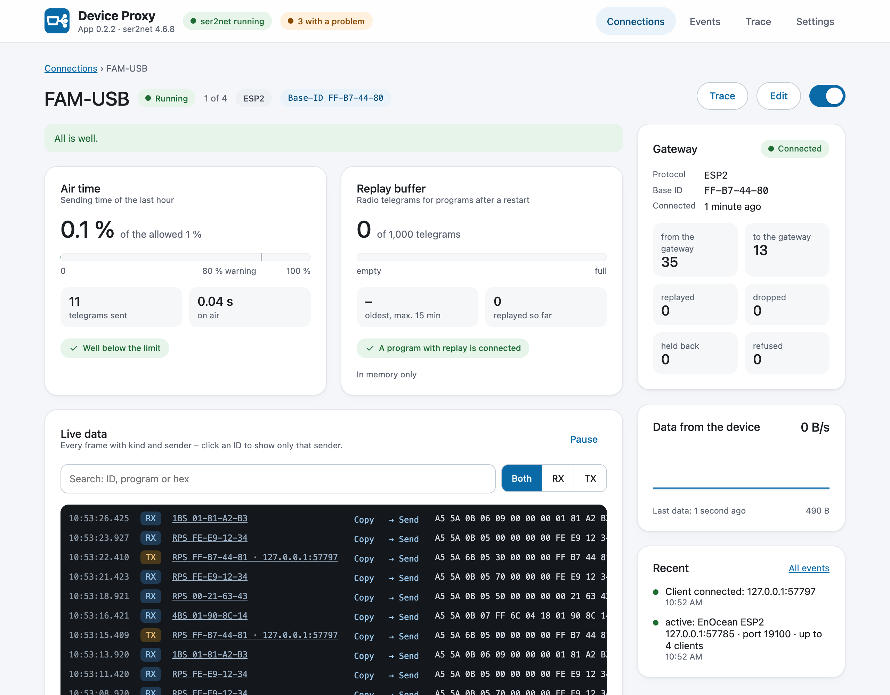

<p align="center">
  
</p>

<h1 align="center">Device Proxy</h1>

<p align="center">
  Share serial, USB, Modbus and EnOcean devices with several programs: ser2net, a Modbus proxy and an EnOcean proxy as a Home Assistant app.
</p>

<p align="center">
  <a href="https://www.home-assistant.io/"></a>
  <a href="device_proxy/config.yaml"></a>
  
  <a href="https://github.com/bertel2020/HA-Device-Proxy/actions/workflows/ci.yml"></a>
  <a href="LICENSE"></a>
</p>

<p align="center">
  <a href="https://buymeacoffee.com/bertel2020"></a>
  <a href="https://ko-fi.com/bertel2020"></a>
  <a href="https://paypal.me/RobertoMartins"></a>
</p>

<p align="center"><em><a href="https://github.com/bertel2020/HA-Device-Proxy/blob/main/README.de.md">Deutsche Version</a></em></p>

Device Proxy is a Home Assistant app (formerly add-on) that makes a device usable by several programs at once. Serial and USB devices (smart meter reading heads, Z-Wave or Zigbee sticks, RS232 devices) are shared over TCP with [ser2net 4](https://github.com/cminyard/ser2net). Modbus devices (Modbus TCP, Modbus RTU on RS485, RTU over TCP) are shared with several Modbus TCP clients through the app's own Modbus proxy. EnOcean gateways (FAM-USB, FAM14, USB300, MGW-ETH …) are shared through its own EnOcean proxy, with replay for Home Assistant restarts.

Everything is set up in a web interface in the sidebar: no YAML, no command line. The app's **Configuration** tab in the Supervisor stays empty on purpose; everything is in the sidebar entry **Device Proxy**. Status, live data, traces and events show what is happening on the line.

> Work in progress, not tested on Home Assistant yet. Needs Home Assistant OS or Supervised (apps run under the Supervisor).

## Screenshots

<p align="center">
  
</p>

| Modbus device | Edit a connection |
| --- | --- |
|  |  |

| Trace | Import |
| --- | --- |
|  |  |

<p align="center">
  
</p>

## Why Device Proxy?

Many devices accept only one connection: a USB reading head on the smart meter, a Z-Wave stick, an inverter's Modbus TCP port, an RS485 bus. As soon as a second program wants the data (a second Home Assistant, evcc, an energy manager, a diagnostic tool), they get in each other's way or one of them loses.

Device Proxy sits in between. It holds the device and lets several clients use it, in turn where the protocol needs it, and shows who is connected and whether data flows. Configuration that used to live in a `ser2net.yaml` or in the options of separate apps is in one place.

## Highlights

- **Connections in a web interface**: device from a list with stable names, templates (smart meter SML or D0, Z-Wave stick, Modbus), all important ser2net options and a live `ser2net.yaml` preview. Saving rebuilds only that connection; the others keep their clients.
- **Modbus proxy**: one Modbus device or RS485 bus for several Modbus TCP clients. Requests go to the device one after another and each answer back to the client that asked; timeouts, retries and pauses are adjustable. Writes only from Home Assistant and apps by default, a cache for reads, a bus scan and a register reader.
- **EnOcean gateways**: one FAM-USB, FAM14, USB300 or MGW-ETH for the EnOcean Eltako integration, eo_man and PCT14 at once. Whole frames in turn, answers to the program that asked, telegrams missed during a Home Assistant restart replayed with their reception time, discovery by the integration. Live frames with sender and kind, air time against the 1 % limit, gateway test, sending a checked frame, captures with a lock for PCT14. Replaces the EnOcean Proxy app.
- **Status at a glance**: device present, clients with address and bytes, data rate, last data, line errors from the driver, Modbus requests and answer times; clients that stop reading are spotted.
- **Live data and traces** without taking a client place, decoded for Modbus; recording to rotating files without disconnecting anyone.
- **Smart meter tools**: SML (with CRC check) and D0 decoded, baud rate detection.
- **Import and export**: ser2net 4 `ser2net.yaml`, ser2net 3 `ser2net.conf`, the options of the ha-modbusproxy or EnOcean Proxy app or a modbus-proxy file, with a preview. Or use your own `ser2net.yaml` as it is.
- **Events and history** (30 days, drops and availability), configuration history with differences and restore.
- **Notifications** in Home Assistant, optionally to a phone, and **entities over MQTT discovery**: one device per connection with its state and a switch.
- German and English, light and dark (following Home Assistant's theme), phone width.

## Quick start

1. Add this repository to Home Assistant with the button below, or under **Settings → Apps → App store → ⋮ → Repositories** with `https://github.com/bertel2020/HA-Device-Proxy`.

   [](https://my.home-assistant.io/redirect/supervisor_add_addon_repository/?repository_url=https%3A%2F%2Fgithub.com%2Fbertel2020%2FHA-Device-Proxy)

2. Install **Device Proxy** and start it. Until prebuilt images are published, Home Assistant builds the app on install (gensio and ser2net included), which takes a few minutes the first time.
3. Open **Device Proxy** in the sidebar and add a connection: pick the device and a template, save. The card shows the address to enter in the integration, for example `tcp://127.0.0.1:3333` or a Modbus host and port.
4. Coming from ser2net, ha-modbusproxy or the EnOcean Proxy app? **Import / Export** takes over the existing configuration with a preview.

Every page, every setting and help when something does not work: **[documentation](device_proxy/DOCS.md)** (also shown in Home Assistant on the app's Documentation tab).

## Safety in short

- The ports are plain TCP without a login. New connections accept clients from private networks only; the Z-Wave template limits them to Home Assistant and its apps. Under **Settings → Network** this can be narrowed further.
- Modbus connections let only Home Assistant and the apps write by default; other clients can only read. EnOcean gateways take Home Assistant and the apps only, unless more addresses are allowed.
- ser2net's admin interface is reachable from inside the app only; the web interface is reached through Home Assistant (Ingress).
- Diagnostics leave out host names and personal names.

## Changelog

See [device_proxy/CHANGELOG.md](device_proxy/CHANGELOG.md); Home Assistant shows it before an update.

## Development

```bash
python -m pip install -r requirements_test.txt
ruff check .
mypy
python -m pytest
```

The web interface is built from `panel-src/` (`npm ci && node build.mjs` there); `tools/dev_server.py` runs it on a desktop with example connections. `tools/render_images.py` draws `icon.png` and `logo.png`.

## Thanks

The EnOcean part builds on the work of others:

- [grimmpp](https://github.com/grimmpp) (Philipp Grimm) for [home-assistant-eltako](https://github.com/grimmpp/home-assistant-eltako), [eltako14bus](https://github.com/grimmpp/eltako14bus) and [esp2_gateway_adapter](https://github.com/grimmpp/esp2_gateway_adapter), the origin of the Eltako support. `eltako14bus` goes back to Christian Amsüss and Energy Harvesting Solutions (2016–2020).
- [chrysn](https://github.com/chrysn), Johannes Bosecker, Cedric Van Labeke and LHBL2003, who contributed to `home-assistant-eltako`.
- Kimmo Huoman ([kipe/enocean](https://github.com/kipe/enocean), via the fork [mak-gitdev/enocean](https://github.com/mak-gitdev/enocean)) for the EnOcean protocol library.

## Disclaimer

Device Proxy is a privately developed, free open-source project and is provided without warranty or guarantee. Use is at your own risk; in particular, no guarantee can be given for error-free operation, for the availability of the shared devices or for the correctness of the data passed through. **Device Proxy passes data and commands from clients to your devices, including writes to Modbus devices such as inverters or heat pumps. Check who may connect and write before you share a device on the network.**

## License

This project is released under the [MIT License](LICENSE).
Copyright 2026 Roberto / bertel2020.
ser2net and gensio (both GPL-2.0, see their repositories) are built from their releases into the image.
